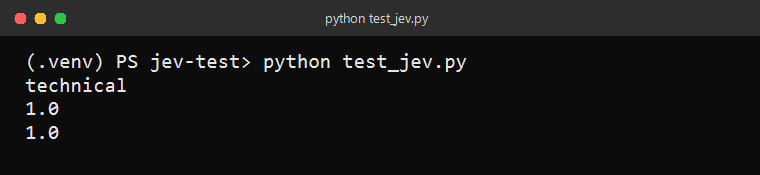
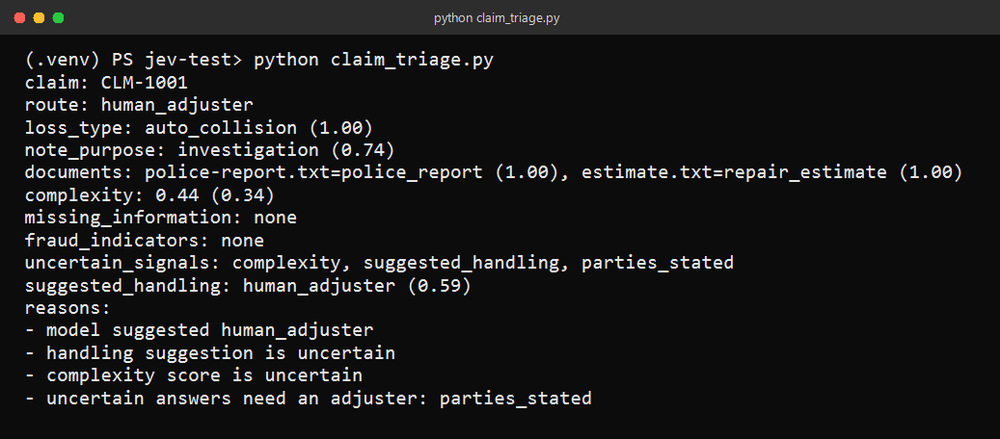
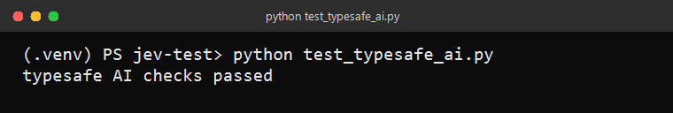

# jev-test

Small Python project for [TypeSafe AI](https://docs.typesafe.ai/). It asks typed questions about a piece of text, then uses the returned probabilities to decide what to do next.

`test_jev.py` classifies a support ticket. `claim_triage.py` reads a first notice of loss, adjuster notes, and supporting documents, then routes the claim. `test_typesafe_ai.py` checks typed agent behavior locally and does not call TypeSafe.

## Setup

Python 3.11 is required. From this folder:

```powershell
py -3 -m venv .venv
.\.venv\Scripts\Activate.ps1
python -m pip install -r requirements.txt
```

Create a `.env` file in the project root. The client reads `TYPESAFE_API_KEY`:

```text
TYPESAFE_API_KEY=your_key_here
```

`.env` and `.venv` are listed in `.gitignore`.

## Run

```powershell
python test_jev.py
python claim_triage.py
python test_typesafe_ai.py
```

`requests.https` is a REST Client file. Each block is one HTTP call, and the comment under the title is the same call as `curl`.

## Sample output

A support ticket is routed to technical, with frustration and urgency both at 1.0:



A sample rear-end claim is classified as an auto collision. Complexity and one required fact are uncertain, so the file goes to a human adjuster instead of straight-through processing:



The local type-safe checks do not need an API key:



Live TypeSafe answers can shift a little between calls. The screenshots are from real runs of the sample inputs in those files.

## Claim routing

`claim_triage.py` sends the whole claim in one `system_one` request.

- **Choice** classifies the loss, the adjuster note, each document, and a suggested handling path.
- **Score** rates complexity from a simple loss to injury, conflict, or a coverage dispute.
- **Noul** checks whether required facts are present and whether fraud-review indicators appear. An indicator sends the file to a person. It is not a finding that fraud occurred.

Straight-through processing is used only when the file is simple, complete, and the answers are confident. Missing information goes to specialist review. Uncertain answers and fraud indicators escalate to a human adjuster. A more cautious suggestion is never replaced with a lighter one.

Pass your own file to `triage_claim(client, claim)`. `ClaimFile` takes a claim id, the first notice of loss, adjuster notes, and optional `ClaimDocument` entries.

## What gets pushed

Safe to commit: the Python files, `requirements.txt`, `requests.https`, `.gitignore`, this README, and `screenshots/`.

Leave `.env` and `.venv/` on your machine. After you create the GitHub repo:

```powershell
git add .gitignore README.md claim_triage.py requests.https requirements.txt test_jev.py test_typesafe_ai.py screenshots
git commit -m "Add TypeSafe examples and claim triage."
git remote add origin https://github.com/YOUR_USER/YOUR_REPO.git
git push -u origin main
```
